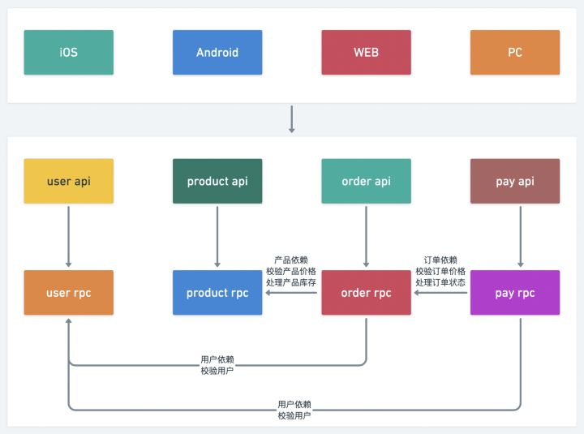

# 微服务实践 
```
              _                                            _                             __   
   ____ ___  (_)_____________        ________  ______   __(_)_______     _________  ____/ /__ 
  / __ `__ \/ / ___/ ___/ __ \______/ ___/ _ \/ ___/ | / / / ___/ _ \   / ___/ __ \/ __  / _ \
 / / / / / / / /__/ /  / /_/ /_____(__  )  __/ /   | |/ / / /__/  __/  / /__/ /_/ / /_/ /  __/
/_/ /_/ /_/_/\___/_/   \____/     /____/\___/_/    |___/_/\___/\___/   \___/\____/\__,_/\___/ 
                                                                                              
```

### 写在开头  
感谢go-zero作者万老师提供的 `go-zero` 入门学习教程的示例代码  
详细教程:[go-zero实战：让微服务Go起来](https://juejin.cn/post/7036011047391592485)。  

## 项目说明
go-zero配合docker环境快速搭建微服务架构的商城系统，以下各服务均需要在goland容器中启动  
此仓库为具体实现代码  
docker环境部署文件可以[参考此处](https://github.com/bestHeCC/microservices-by-docker)。

## 服务拆分示意图



## Release Notes

~~~
v1.0.0 (2022-02-16)
* 第一次提交，实现用户服务
* 启动 user rpc 服务
cd mall/service/user/rpc && go run user.go -f etc/user.yaml
* 启动 user api 服务
cd mall/service/user/api && go run user.go -f etc/user.yaml
~~~

~~~
v1.1.0 (2022-02-25)
* 实现商品服务
* 启动 product rpc 服务
cd mall/service/product/rpc && go run product.go -f etc/product.yaml
* 启动 product api 服务
cd mall/service/product/api && go run product.go -f etc/product.yaml
~~~

~~~
v1.2.0 (2022-02-28)
* 实现订单服务
* 启动 order rpc 服务
cd mall/service/order/rpc && go run order.go -f etc/order.yaml
* 启动 order api 服务
cd mall/service/order/api && go run order.go -f etc/order.yaml
~~~

~~~
v1.3.0 (2022-03-07)
* 实现支付服务
* 启动 pay rpc 服务
cd mall/service/pay/rpc && go run pay.go -f etc/pay.yaml
* 启动 pay api 服务
cd mall/service/pay/api && go run pay.go -f etc/pay.yaml
~~~

~~~
v1.4.0 (2022-03-07)
* RPC服务添加auth验证
go-zero 框架 rpc 服务的 auth 验证原理是，
客户端访问 rpc 服务需要携带 App 标识以及 Token 值，
rpc 服务会从指定的 Redis 服务中验证 App 标识和 Token 值是否正确。
所以客户端的 App 标识，Token 值，是需要提前写入 Redis 中。

写入redis的规则如下(以user rpc为例)：
指定 key为rpc:auth:user，数据类型为hash
App 标识作为 rpc 指定 key 的 hash key，Token 值作为 hash key 的值。

因为order，pay rpc依赖user rpc，所以这两个rpc也要进行对应配置，否则无法通过user rpc的auth验证
同理，order rpc依赖procut rpc，pay rpc依赖order rpc，均要进行对应配置
~~~
